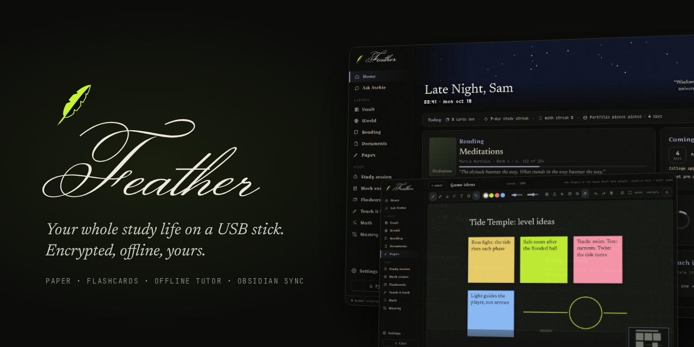
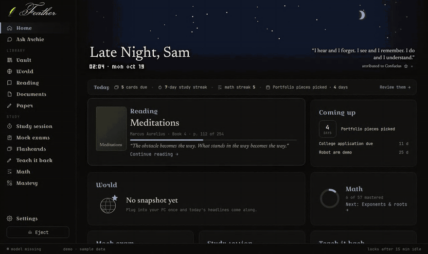
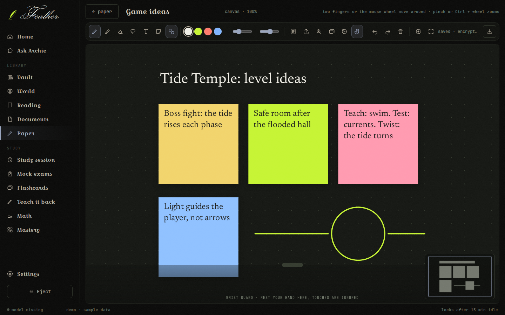
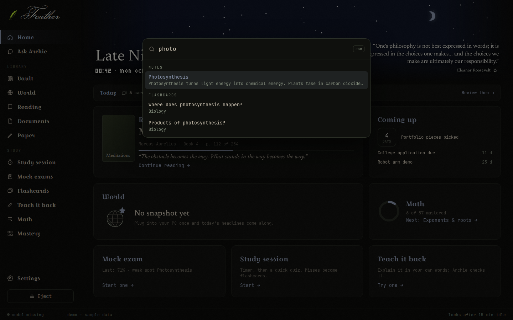
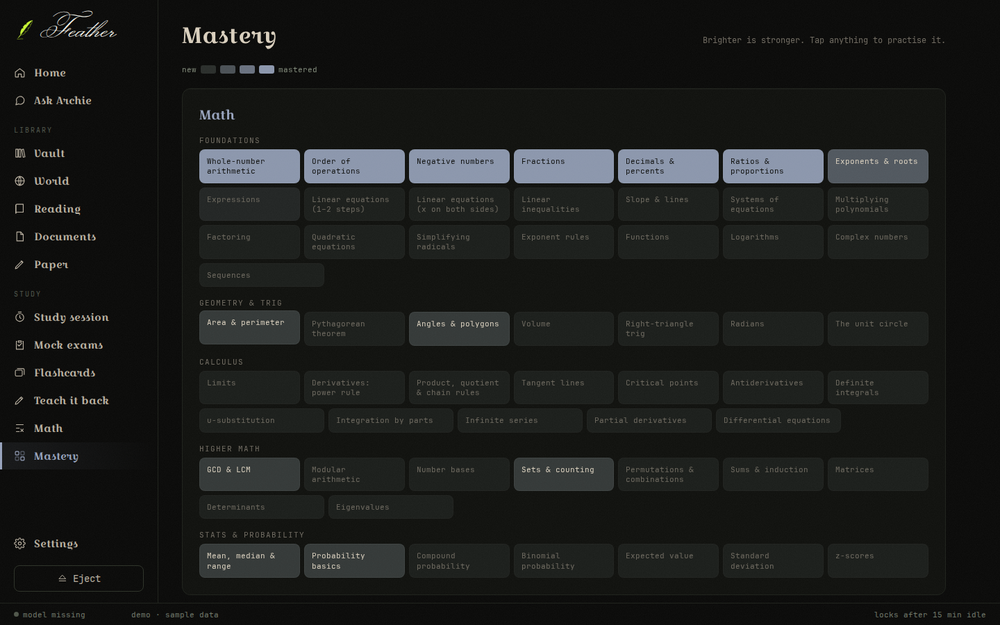
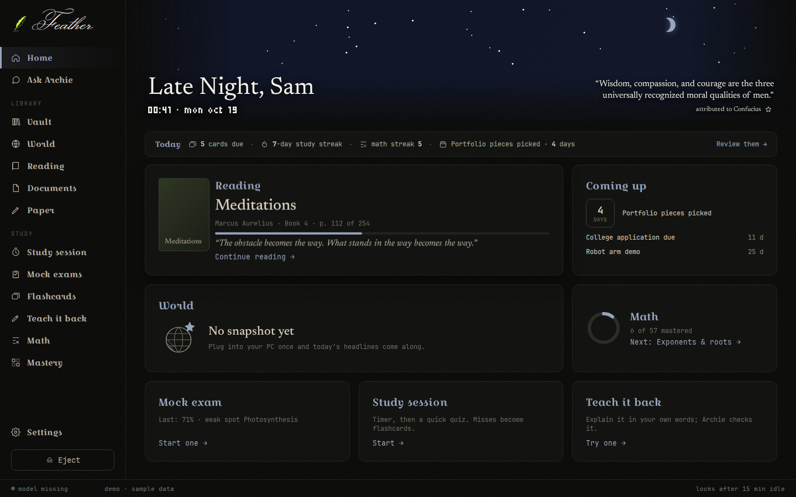
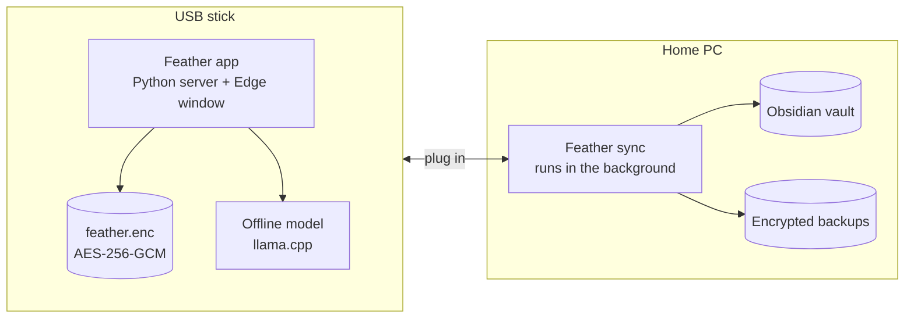

<p align="center"></p>

<p align="center">
  <b>A study companion that lives on a USB stick.</b><br>
  Notes, flashcards, handwritten pages, a reading log and an offline AI tutor, encrypted on the stick and working without the internet.
</p>

<p align="center">
  <a href="#what-it-does">What it does</a> ·
  <a href="#try-the-demo">Try the demo</a> ·
  <a href="#set-up">Set up</a> ·
  <a href="#how-it-works">How it works</a> ·
  <a href="docs/SECURITY.md">Security</a> ·
  <a href="CHANGELOG.md">Changelog</a>
</p>

<p align="center"></p>

---

Plug Feather into any Windows laptop and it opens, with nothing to install. Plug it into your home PC and it syncs with [Obsidian](https://obsidian.md) by itself: your study logs and handwritten pages go in, the notes you choose come out. Lose the stick and whoever finds it gets nothing, because everything personal is AES-256 encrypted with a key that only exists while you're using it.

I built it because I wanted one place to study that went everywhere with me, worked offline, and didn't belong to anyone else.

## What it does

<table>
<tr>
<td width="50%" valign="top">

<h3>Paper</h3>
Write with a pen, a finger or any stylus. Lined notebooks, an endless canvas, and flipbooks that export as GIFs. Import a PDF and write on it. Windows reads your handwriting, so pages become searchable, and any page can be replayed stroke by stroke.
</td>
<td width="50%" valign="top">

<h3>Find anything</h3>
<kbd>Ctrl</kbd>+<kbd>K</kbd> searches notes, flashcards, books, handwritten pages and the offline libraries from anywhere. Type <code>define:</code> and a word for the offline dictionary.
</td>
</tr>
<tr>
<td width="50%" valign="top">

<h3>Study</h3>
Flashcards with spaced review; lasso a question and its answer on a page to make a card. Mock exams, timed study sessions and teach-it-back, run by a local language model. A math tutor that places you and works through 57 topics, and a mastery map of what's strong and what's slipping.
</td>
<td width="50%" valign="top">

<h3>A home that knows the time</h3>
The greeting, accent colour and banner shift from morning to late night. The Today strip shows cards due, streaks and the next deadline. The Vault reads offline libraries like Wikipedia; World shows the news from your last sync.
</td>
</tr>
</table>

## Try the demo

```
python app/feather.py --demo
```

Demo mode opens a made-up student's Feather (password `demo`) in its own folder, so it never touches real data. On a stick, double-click `Feather Demo.bat`. Every screenshot here comes from it.

## Set up

1. Put this folder on your PC, for example `D:\Feather`, and double-click **Feather Setup.pyw**.
2. Pick your Obsidian vault and type your name. Setup installs what sync needs and starts it with Windows.
3. Plug in a USB stick and press **make / update stick**. It copies the app, a portable Python and the offline model (about 2 GB).
4. On any laptop, open `Start Feather.bat` on the stick and make a password. There's no way to recover it, by design.

Only what you put in `Feather\Notes` inside your vault goes onto the stick: notes, plus PDFs, EPUBs and text files for Documents. Books open in the reader in chapters, with highlights and notes; a Project Gutenberg download like War and Peace works as is.

## How it works



- **Nothing to install on a laptop.** The stick carries portable Python, its libraries and the model. The app is a small local server opened in an Edge app window.
- **No frameworks.** The interface is plain JavaScript and CSS. The Paper engine (pressure strokes, camera, palm rejection, lasso, onion skin) is about 1,000 lines written from scratch.
- **Locked down.** scrypt key derivation, a fresh nonce on every write, a 15-minute idle lock, and a local server that refuses requests from any page but its own. Details in [SECURITY.md](docs/SECURITY.md).
- **Accessible.** Keyboard reachable, visible focus, WCAG AA contrast, reduced motion respected. See [ACCESSIBILITY.md](docs/ACCESSIBILITY.md).

| Folder | What's in it |
|---|---|
| [`app/`](app) | The app that runs from the stick: the local server, the encrypted store, the offline model, and the interface in `web/`. |
| [`sync/`](sync) | The PC side: background sync with Obsidian and Archie, book parsing, and making sticks. |
| [`runtime/`](runtime) | Files copied onto the stick so it runs on any laptop. |
| [`docs/`](docs) | Security, accessibility, screenshots. |
| [`icon/`](icon) | The quill icon. |
| `Feather Setup.pyw` | One window on the PC for setup, sticks and backups. |

## Tests

```
pip install cryptography pytest
pytest
```

The tests cover the encryption (including a password change re-encrypting every file), splitting books into chapters, the calendar changes written into Archie's files, the search index, the stick check and repair, and the app itself running in demo mode. GitHub runs them on every push.

## Built with

Python, plain JavaScript, [pdf.js](https://mozilla.github.io/pdf.js/), [KaTeX](https://katex.org/), [gifenc](https://github.com/mattdesl/gifenc), [llama.cpp](https://github.com/ggerganov/llama.cpp) running Qwen2.5 3B, [libzim](https://github.com/openzim/python-libzim) and the Python [cryptography](https://cryptography.io/) library. Full credits are on the About screen in Settings.

Windows only for now: handwriting recognition and the PC sync use Windows features.

## Licence

Feather is under the [MIT licence](LICENSE). The libraries it uses keep their own licences (pdf.js Apache 2.0, KaTeX and gifenc MIT, fonts SIL OFL); they're listed in Settings › About and next to each library in `app/web`.
